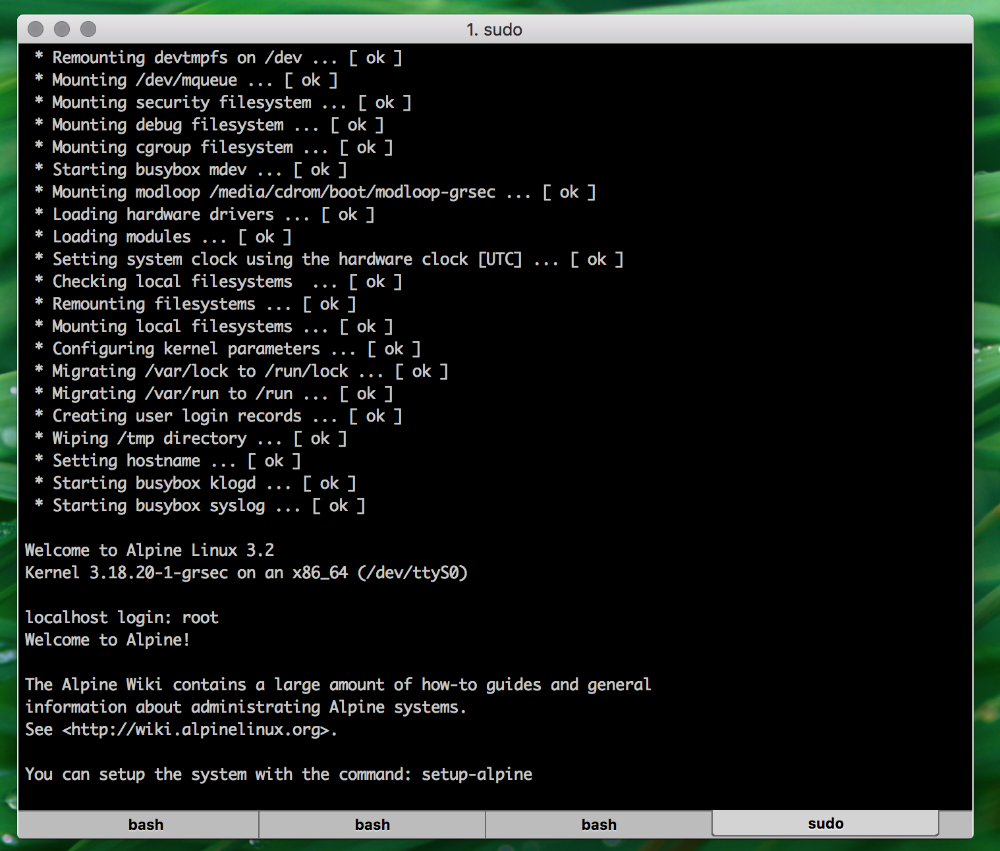

During the 2015 Xmas holiday break I’ve been meaning to play around with Docker or in particular CoreOS on my Mac machine. I know it’s pretty easy to whip with a few CLI commands — Vagrant + VirtualBox, done! — but I wanted something different and wanted to avoid too many abstraction eg. running a virtual environment on top of a virtual environment. A few google searches got me into xhyve, can’t remember the exact keywords I used — sorry.

xhyve is relatively a new project, roughly 7 months old as of this writing, out of curiosity I jumped right away and see if I could install Alpine Linux. On the side note, the reason I’m looking at running Alpine Linux because it was mentioned at Vagga’s documentation, period, I will do a post about Vagga.

I haven’t used Alpine Linux before but luckily I found this Tweet and the link to the blog — thanks to Aria Stewart ;). I then grabbed the latest Alpine release `alpine-3.3.0-x86_64.iso` but I ran into a hell lot of booting issues, my first night wasn’t a success. The following day, I realised that scavenging through forums, stackoverflow, & etc isn’t gonna help me out even just getting the basic Alpine boot up and decided to just use the version `alpine-3.2.3-x86_64.iso` used by Aria. It definitely works but ran into a couple minor issues so I decided to chuck it into a Bash script and make changes as I go.

Here’s my Github gist

```bash
#!/bin/sh

KERNEL="vmlinuz-grsec"
INITRD="initramfs-grsec"
CMDLINE="alpine_dev=cdrom:iso9660 modules=loop,squashfs,sd-mod,usb-storage,sr-mod,earlyprintk=serial console=ttyS0"

MEM="-m 1G"
IMG_CD="-s 3,ahci-cd,alpine-3.2.3-x86_64.iso"
PCI_DEV="-s 0:0,hostbridge -s 31,lpc"
LPC_DEV="-l com1,stdio"
ACPI="-A"
#SMP="-c 2"

# sudo if you want networking enabled
NET="-s 2:0,virtio-net"

xhyve $ACPI $MEM $SMP $PCI_DEV $LPC_DEV $NET $IMG_CD $IMG_HDD -f kexec,$KERNEL,$INITRD,"$CMDLINE"

```

After a successful boot up




One last thing, definitely worth looking into is running CoreOS inside xhyve!

Some references I’ve found while working on the install process

* https://coreos.com/blog/coreos-and-xhyve-tech-preview.html
* https://github.com/ailispaw/boot2docker-xhyve
* https://medium.com/the-journey-of-code/creating-virtual-dev-environment-with-xhyve-fe501005fc6c#.jdmy6icbv

### Update: 8/May/2016

Just after 2 months writing about xhyve + alpine,
Docker announced they would go native for their Docker engine on top of xhyve — 
and just 2 days ago I got accepted for testing Docker for Mac.
