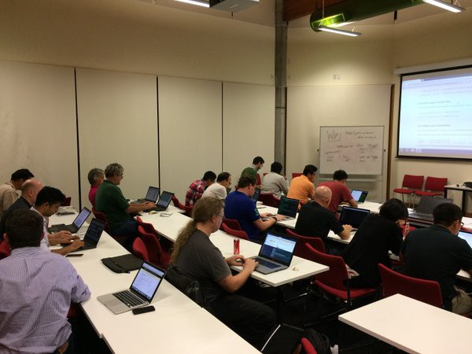
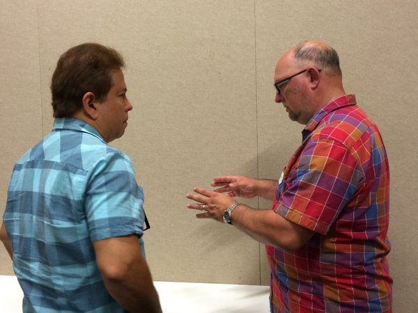
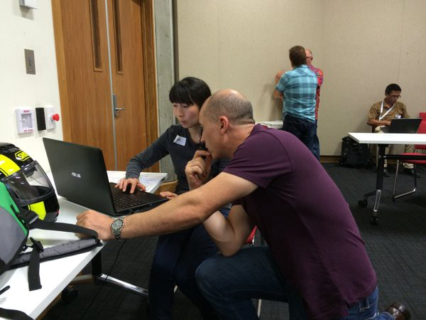

 
source : https://twitter.com/dockerakl/status/711820276942528512

> Thanks for the event! I really enjoyed the Docker crash course, it was certainly an eye-opener for me :)
>
> HUGE thanks. Get me started with docker:P

Attendees feedback, how cool is that ?! it was held on 21 of March 2016

---

I thought it was a good meetup, the room wasn’t really that packed but it was a good crowd.
Although, was a bit lost and had to find my way through the conference room but location-wise ? really good.

I wasn’t expecting to be doing a lot of hands on and didn’t bring my laptop, just wanted to sit down , watch & listen — ha! — wrong.
I was about to shoot off early but managed to sit down with someone and did a bit of agile-ish Docker training — kind of pair programming if you like, hurray!

---

The organisers were friendly and helpful

 
source: https://twitter.com/dockerakl/status/711820276942528512

 
source: https://twitter.com/dockerakl/status/711820276942528512

### Lessons Learned

If they will say bring a computer, then bring a computer!

### Finally!

Kudos to the [organisers](http://www.meetup.com/Docker-Auckland/members/?op=leaders) \cc [@dockerakl](https://twitter.com/dockerakl)
