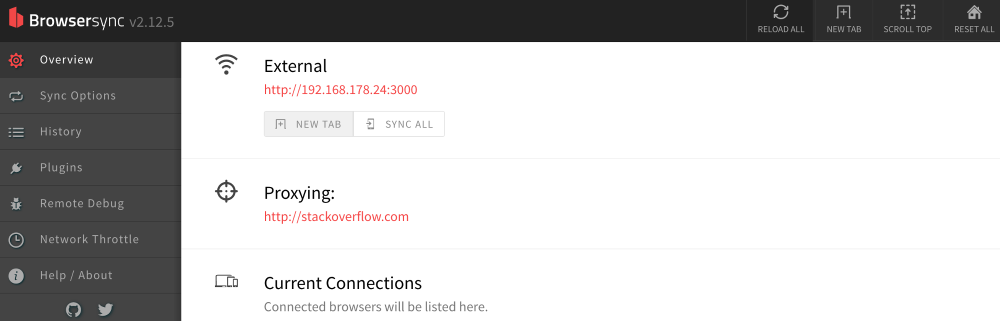
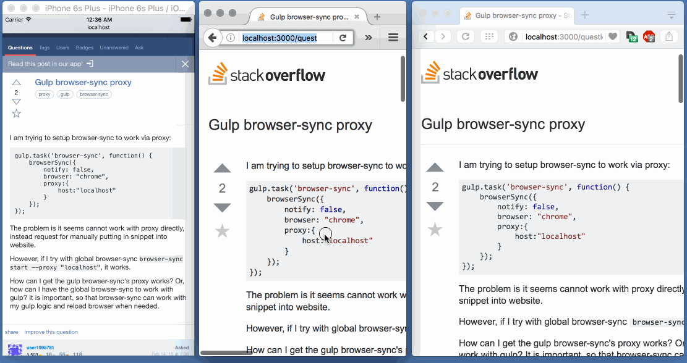

Looking at few stats: [6.9k](https://github.com/BrowserSync/browser-sync/stargazers) Github stars and [700k](https://www.npmjs.com/package/browser-sync) npm downloads in the last month
(at the time of this writing) it’s no wonder that you can always find plugins,
tools or utilities that will link up Browsersync with your favourite frontend
or server side framework to ease up your browser testing. It is packed with good
features as mentioned in Addy Osmani’s 2013 blog but its ghostMode and Proxy options
are spot on in my opinion.

* ghostMode — Clicks, Scrolls & Form inputs on any device will be mirrored to all others.
* Proxy — Acts as an intermediary or a mini server between the browser and your backend/api/webapp (sounds about right eh, I guess)

> Let’s try the “fast food” way so we can use the two options without writing a single line of code and become productive , right now— c’mon! are you sure ? you asked.

---

### The Ghost and the Pretender

Here’s the basic steps to utilise ghostMode and Proxy options with your web app:

1.) Install browsersync

```bash
$> npm install -g browser-sync
```

2.) Start browsersync as proxy against your webapp, we’ll use http://stackoverflow.com/ as an example

```bash
$> browser-sync start --proxy http://stackoverflow.com
```

You will see the following message in terminal:

```bash
[BS] Proxying: http://stackoverflow.com
[BS] Access URLs:
 — — — — — — — — — — — — — — — — — — — -
 Local: http://localhost:3000
 External: http://192.168.178.24:3000
 — — — — — — — — — — — — — — — — — — — -
 UI: http://localhost:3001
 UI External: http://192.168.178.24:3001
```

3.) Navigate to the proxy URL

> [http://localhost:3000](http://localhost:3000)

4.) There’s no #4

5.) Done



---

### Example
Here’s how the proxyfied stackoverflow looks like. On the left is iPhone6 simulator, Firefox in the middle and then Opera.



### Enjoy!
