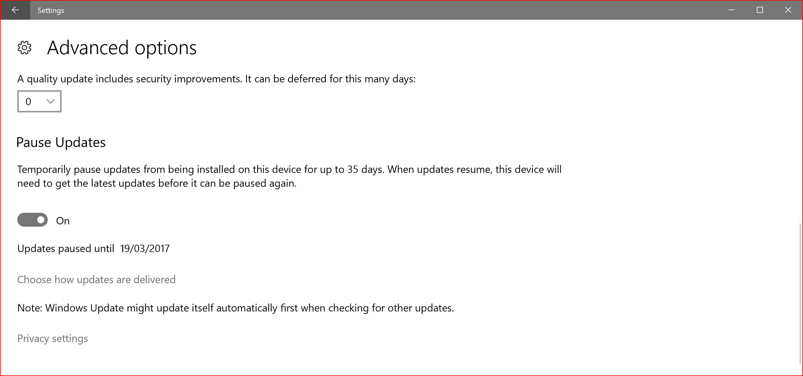

Yesterday 10th of Feb 2017, I managed to update my PC with the latest [Windows 10 Insider Preview Build 15031](https://blogs.windows.com/windowsexperience/2017/02/08/announcing-windows-10-insider-preview-build-15031-pc/#zQAbyxpwEGLAdWvl.97).
The list contains a massive set of features as well as fixes, so I didn't mind the upgrade. It took at least 20mins to get it done. Once done, my NodeJS environment started complaining, btw I am using [Node Version Manager](https://github.com/creationix/nvm).

Here's what I got when switching NodeJS versions:

```
nvm use v4.3.2
net.js:129
    this._handle.open(options.fd);
                 ^

Error: Unknown system error -25: Unknown system error -25, uv_pipe_open
    at Error (native)
    at new Socket (net.js:129:18)
    at createWritableStdioStream (node.js:601:18)
    at process.stdout (node.js:627:16)
    at module.exports (/home/urix/.nvm/versions/node/v4.3.2/lib/node_modules/npm/node_modules/npmlog/node_modules/set-blocking/index.js:2:11)
    at Object.<anonymous> (/home/urix/.nvm/versions/node/v4.3.2/lib/node_modules/npm/node_modules/npmlog/log.js:11:1)
    at Module._compile (module.js:409:26)
    at Object.Module._extensions..js (module.js:416:10)
    at Module.load (module.js:343:32)
    at Function.Module._load (module.js:300:12)
nvm is not compatible with the npm config "prefix" option: currently set to ""
Run `nvm use --delete-prefix v4.3.2` to unset it.
```

luckily, folks at [Bash on Windows were friendly and responsive](https://github.com/Microsoft/BashOnWindows/issues/1683#issuecomment-279101631).
The timeline for the fix is weeks due to that it's a driver issue but unforunately I can't wait as I need to do some NodeJS work related stuff on various releases.
I develop and maintain some antiquated NodeJS releases going back as far as v0.12.x hence NVM is my main tool.

I've switched to the previous inside build prior to 15301 - it took probably less than 5mins to do. I'm now on [Windows Insider Preview Build 15025.100](https://blogs.windows.com/windowsexperience/2017/02/01/announcing-windows-10-insider-preview-build-15025-pc/#kwrCg1TLbgrRzLe0.97)

### Update

Make sure to set `Pause Updates` to `on` to avoid re-installing the latest build 15031 when you restart your PC.



Enjoy!

### Referrences

* https://github.com/Microsoft/BashOnWindows/issues/1683
* https://blogs.windows.com/windowsexperience/2017/02/08/announcing-windows-10-insider-preview-build-15031-pc/#zQAbyxpwEGLAdWvl.97
* https://blogs.windows.com/windowsexperience/2017/02/01/announcing-windows-10-insider-preview-build-15025-pc/#kwrCg1TLbgrRzLe0.97
