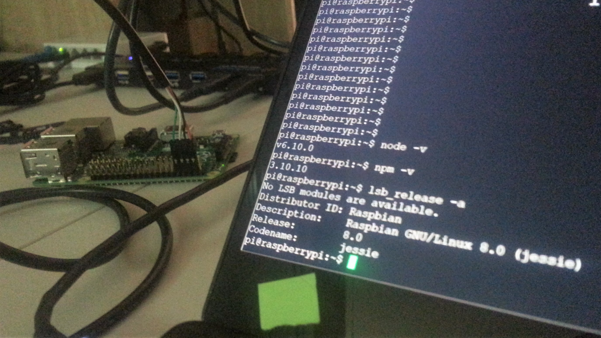

## Copy & Paste, trust me!

```
$> sudo apt-get update
$> sudo apt-get upgrade
$> sudo apt-get -y install git
$> curl -o- https://raw.githubusercontent.com/creationix/nvm/v0.33.1/install.sh | bash
$> source ~/.bashrc
$> nvm install --lts
```
as of this writing my NodeJS LTS version: `v6.10.0`

## What's  The Fuss?

[Node Version Manager (nvm)](https://github.com/creationix/nvm) gets installed, we'll then use it to install whatever is the current [NodeJS LTS](https://github.com/nodejs/LTS) - primarily behind the scenes, it will spear you from crap of load of these commands:

`tax -xvf **armv1**.xz, cd, sudo cp -R /blah/blah/path, rm /some/dir,...`

## Got Proof ?



## Got Issues, or better tips ?

yell out, I'd highly appreciate and always happy hear! Thanks
