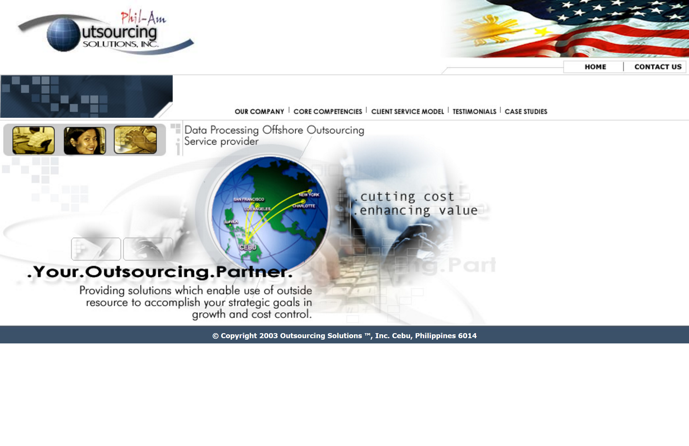

Weekend Saturday morning, my JavaScript Weekly subscription <a href="http://javascriptweekly.com/issues/329" target="_blank">#329</a> had a catchy email subject title __*Opinionated Comparison of React, Angular2, and Aurelia*__, read full article <a href="https://github.com/stickfigure/blog/wiki/Opinionated-Comparison-of-React%2C-Angular2%2C-and-Aurelia?utm_source=javascriptweekly" target="_blank">here</a>

> I have been doing some form of frontend development since the early 90s.

from the blog's first sentence I quickly recalled the first website I designed 14yrs ago, worked started in late 2002 but it was launched in 2003. I remember dabbling with Macromedia's Fireworks and Dreamweaver.

Here's the link to that **Wayback Machine**: https://web.archive.org/web/20030124013620/http://outsourcing-services.net/
Fortunately, the author's meta name still sticks my name on it, hurray!...

If I may recall correctly, I tested this on the following browsers: Internet Explorer, Firefox 0.x - preview release, Netscape Navigator -- to all Chrome bashers/fanatics!, that epic browser wasn't born at that time.
