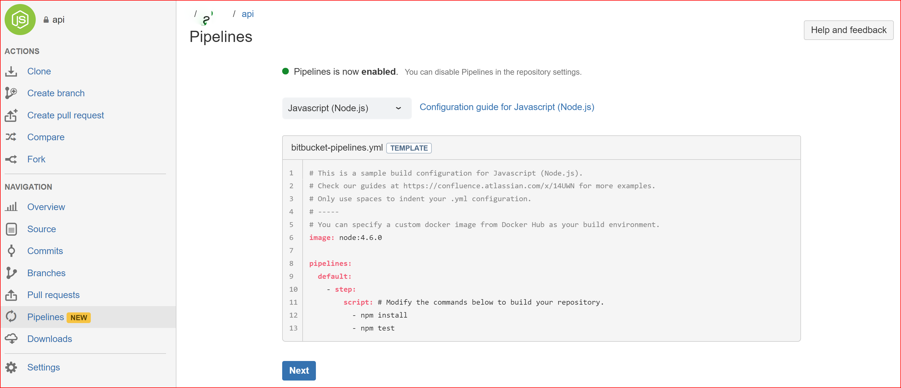
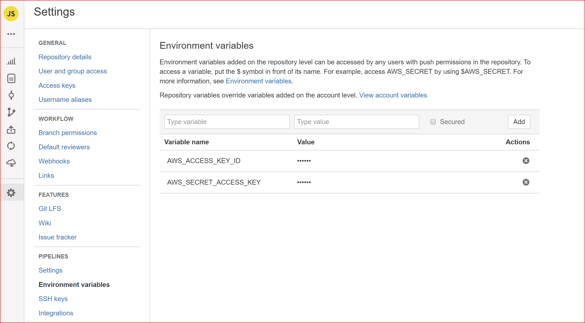
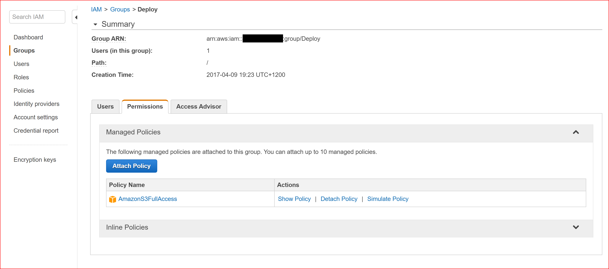
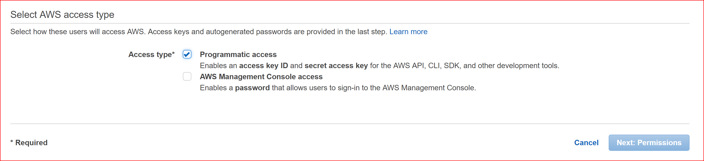
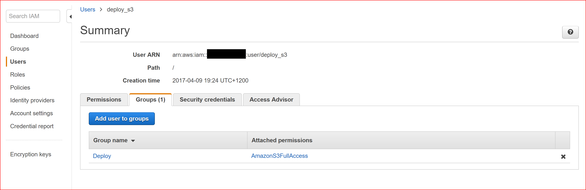
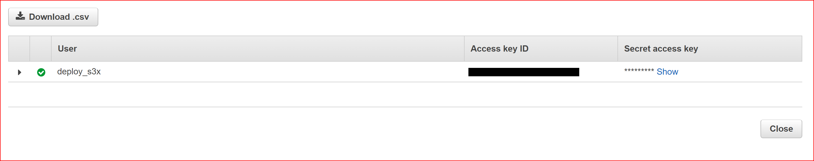
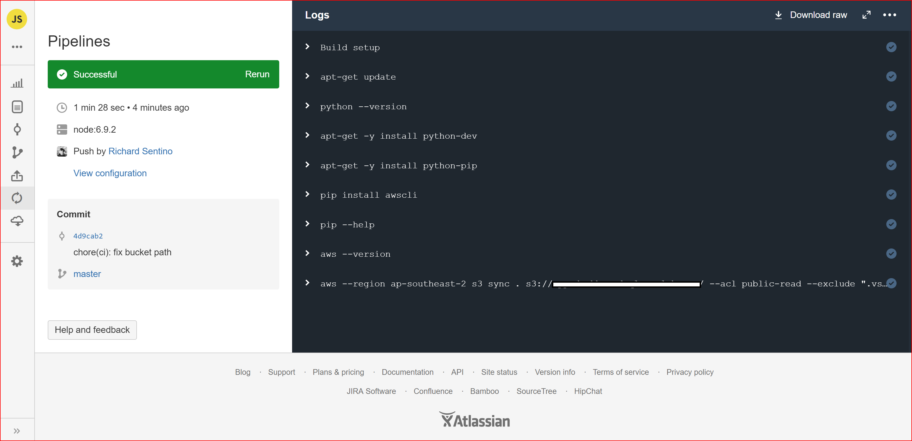

[Bitbucket](https://bitbucket.org/) is my main git repo for all my personal (PoC) projects, portfolio and all of my contracting projects - hands down on private repo.

While I've tried [Codeship](https://codeship.com/), [CircleCI](https://circleci.com/), [Jenkins](https://jenkins.io/) for production use, however, all of these CI server needs some little education about private and public certificates for setting up roles/permission/access before any of them can pull out your source code and push it to eg: *Amazon S3* --- Pipelines + AWS S3 was far bit easier.

I'd say *easy* because it only took me a couple of minutes to configure S3 and Pipeline from nothing to automated deployment. We'll see that in a bit.

## `nuff said, show me!

### Pipelines

There are only 4 steps to enable Pipelines for your project:

* 1. Go to settings
* 2. Enable Pipelines
* 3. Select `bitbucket-pipelines.yml` deployment template
* 4. Commit `bitbucket-pipelines.yml`

Figure below is my default YAML config file for a NodeJS application:



Once you get past #4, you're all pretty much all set.

#### Custom Template

My project is still in super alpha stage, I don't want to trap myself into this complicated build systems like: Webpack, Rollup - not even Angular2 nor React. I just want keep to keep it lean, deliver fast and improve later.

Deployment is done via [AWS Command Line Interface](https://aws.amazon.com/cli/)

bitbucket-pipelines.yml:

```
# This is a sample build configuration for Haskell.
# Check our guides at https://confluence.atlassian.com/x/5Q4SMw for more examples.
# Only use spaces to indent your .yml configuration.
# -----
# You can specify a custom docker image from Docker Hub as your build environment.
image: node:6.9.2

pipelines:
  branches:
    master:
      - step:
          script:
           - apt-get update
           - python --version
           - apt-get -y install python-dev
           - apt-get -y install python-pip
           - pip install awscli
           - pip --help
           - aws --version
           - aws --region ap-southeast-2 s3 sync . s3://path-to-your-s3-bucket/ --acl public-read --exclude ".vscode/*" --exclude ".git/*" --exclude ".gitattributes" --exclude ".gitignore" --exclude ".editorconfig" --exclude "node_modules" --exclude "yarn.lock" --exclude "package.json" --exclude "bitbucket-pipelines.yml"
```

#### Environment Variables

The last line from our `bitbucket-pipelines.yml` requires *AWS_ACCESS_KEY_ID* and *AWS_SECRET_ACCESS_KEY*. We'll stick each value in Pipelines environment variable section. During the build process, Bitbucket populates these values in shell environment eg: export AWS_ACCESS_KEY_ID=<whatever key id>.

`aws` command line interface on the other hand, will react accordingly that we're trying to override one of the default options once it sees `AWS_ACCESS_KEY_ID` and `AWS_SECRET_ACCESS_KEY` in environment variables. see [config-settings-and-precedence]( https://docs.aws.amazon.com/cli/latest/userguide/cli-chap-getting-started.html#config-settings-and-precedence)



Provide a dummy value for now, we'll get one in a bit.

### Amazon S3

We'll configure the S3 deployment using [AWS Identity and Access Management](https://aws.amazon.com/iam/) tool.

- Create Group called `Deploy`
- Attach `AmazonS3FullAccess` permission to your Group
- Create user named `deploy_s3`
- Select `Programmatic access` for `deploy_s3` access type
- Attach `deploy_s3` user to your `Deploy` group
- Copy AWS_ACCESS_KEY_ID and AWS_SECRET_ACCESS_KEY

#### Deploy Group



#### User deploy_s3 Access Type
Tick the box *Programmatic Access*, we need the Key and Secret values later


#### User deploy_s3 attached to Deploy group



#### User deploy_s3 Credentials

Copy the *Access key ID* and *Secret access key* values and paste it into your Pipelines environment variables



Once you've got everything in placed. Try and push some changes to your master remote branch - check Pipelines status, and check your S3 bucket

## Build it!

Here's a successful build status



got comments, reactions or found typos ? let me know. thanks
