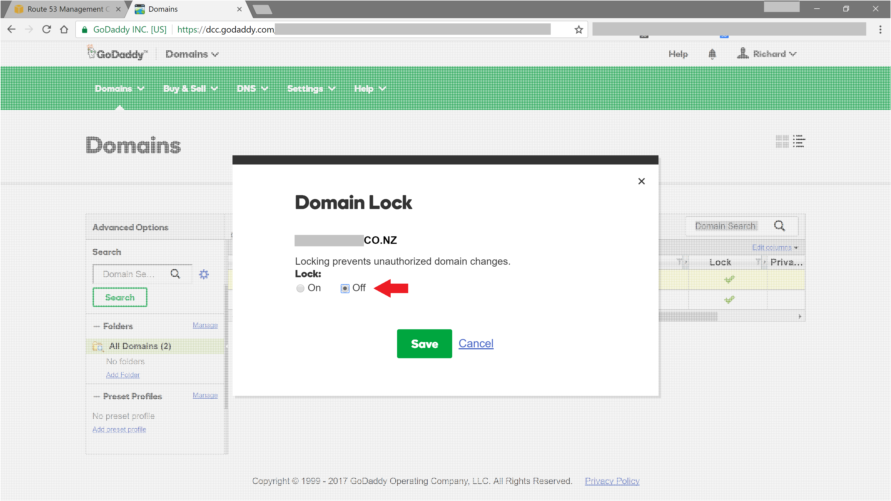
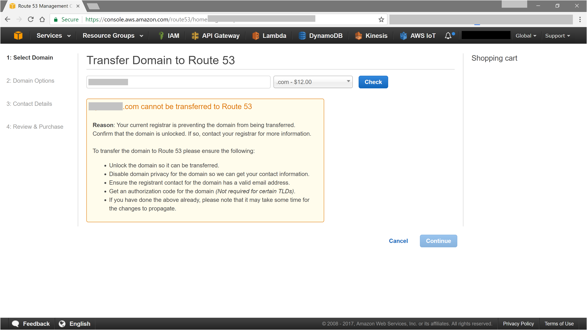
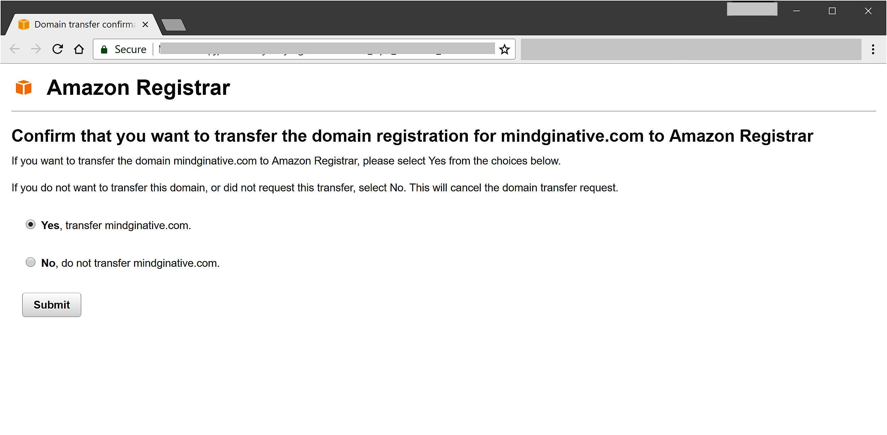
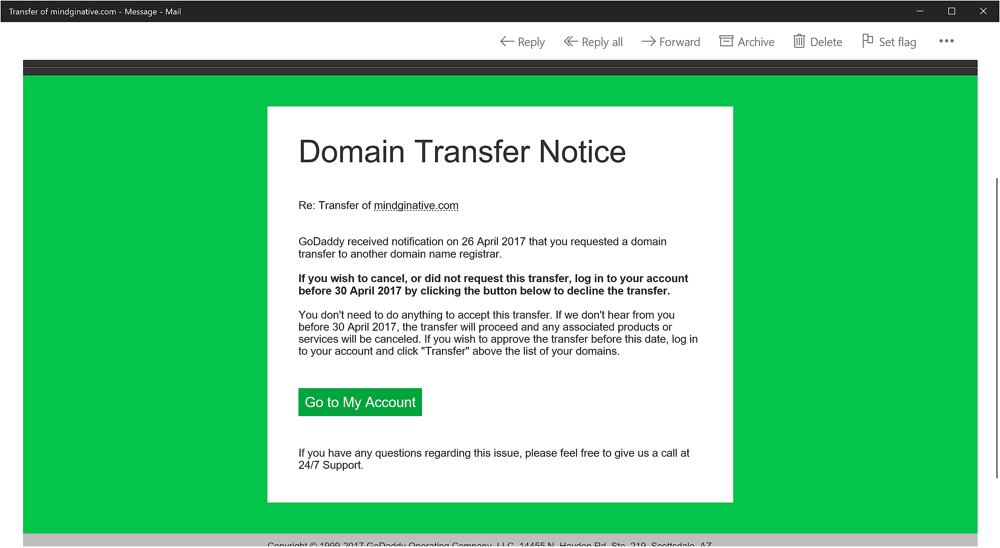
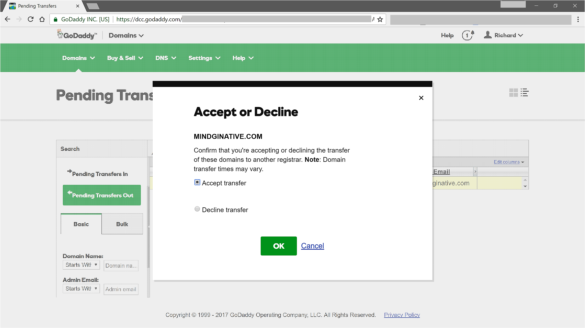
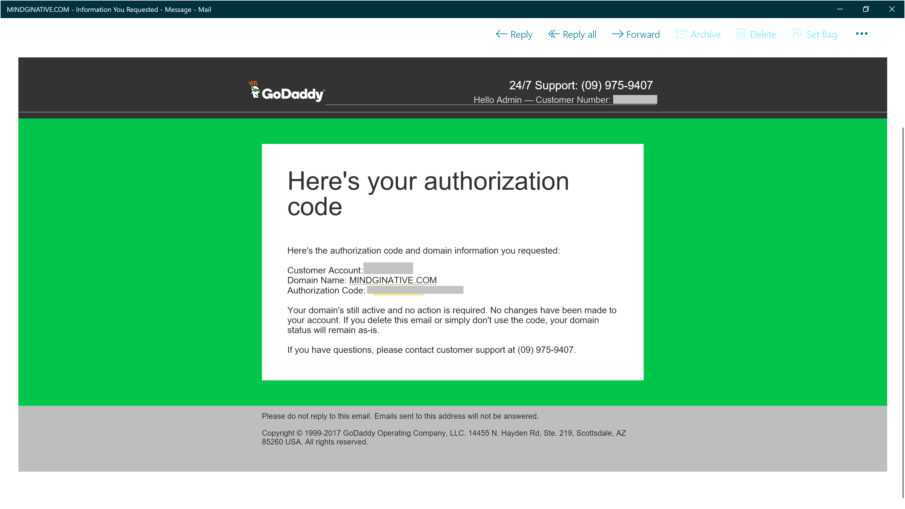
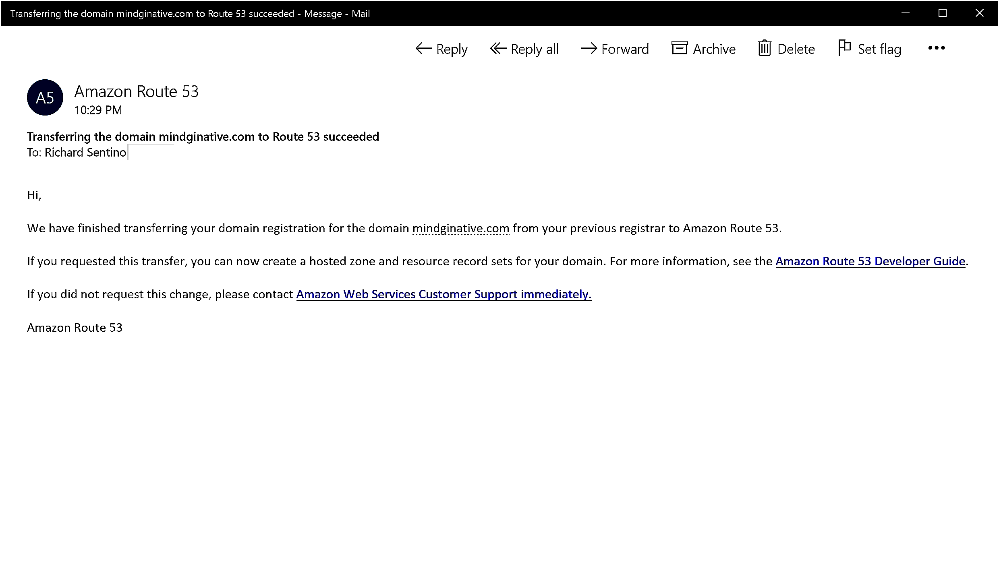
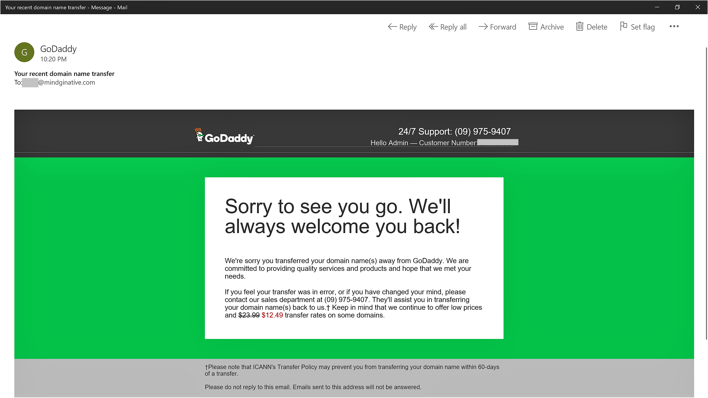

After a fantastic _**9+**_ years with GoDaddy, I moved on - yep, AWS Route53 is the domain registrar for mindginative.com. Nope not because of a horrible things that just happened  nor bad customer experience.

A million reasons:

> They're just my domain provider, I only remember them when it's time to renew my domain - the rest were fully managed by AWS Route53 eg. DNS, Subdomains, Servers, etc.

## Target Audience

It aims at people who are already using AWS Route53 as their DNS provider, for newcomers - I guess you'll have to touch base with DNS first, see [Migrating DNS Service for an existing Domain to Amazon Route53](https://docs.aws.amazon.com/Route53/latest/DeveloperGuide/MigratingDNS.html)

## The Process

I've only spent at most 1 hour from start until I got the final confirmation email from Amazon that they're now the domain registrar of mindginative.

Between the migration process - expect a bunch of emails, notifications, instructions, confirmations from GoDaddy and Amazon.

A word of warning though, before you turn all these knobs you MUST read the [transfer requirements for Top-Level domains](https://docs.aws.amazon.com/Route53/latest/DeveloperGuide/domain-transfer-to-route-53.html#domain-transfer-to-route-53-requirements).

#### Unlock your domain

It's a standard protocol (I guess) for every Domain Registrars to lock your domain - kind of first step security measure for unauthorized domain takeover. So first, unlock it:

#### Start Domain Transfer

Once unlocked, head over to your AWS dashboard:

- 1. Route53 dashboard
- 2. Registered domains
- 3. Transfer Domain

AWS Route53 will always check for unlocked domain status before the actual domain transfer thus a big warning sign should you haven't done it yet.

Follow through the Transfer Domain wizard, fill out the fields - if needed. Confirm the domain transfer, request authorization code.

AWS Route53 initiates a transfer domain request authorization code from GoDaddy.

Before the [EPP code](http://www.tucowsdomains.com/transfer-of-domain-registration/authorizationcode/), a transer notice email:

and then "Accept" the domain transfer:

errr! and then GoDaddy would then provide you the authorization code:

#### All done

You will get a fair amount of emails, a few minutes delay, before getting the final confirmation emails from GoDaddy and Amazon Route53 that your domain has been transfered.

Here's from Amazon:

and GoDaddy:

## Conclusion

The process went well. no hiccups, other than a few slight delays of notifications and or confirmation emails.

I only paid for the domain re-registration this time with AWS being the Domain Registrar. A good time to change Domain Registrar is when your domain is about to expire, say: 1 month from now - mine had only 3 days left with GoDaddy.

The steps and screenshots were lacking some of the steps but you get the gist, yes?

Who knows, 9 years from now I'll move to another Domain Registrar, Google? I don't know but I'd hope by then it'll be easy as QR Code scanning.

Got questions, suggestions, found typos ? let me know.

Enjoy!

## References

* http://godaddy.com
* https://aws.amazon.com/route53/
* https://aws.amazon.com/getting-started/tutorials/get-a-domain/
* https://docs.aws.amazon.com/Route53/latest/DeveloperGuide/domain-transfer-to-route-53.html#domain-transfer-to-route-53-requirements
* https://docs.aws.amazon.com/Route53/latest/DeveloperGuide/MigratingDNS.html
* http://www.tucowsdomains.com/transfer-of-domain-registration/authorizationcode/
