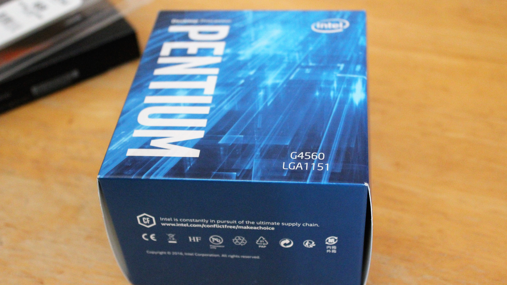
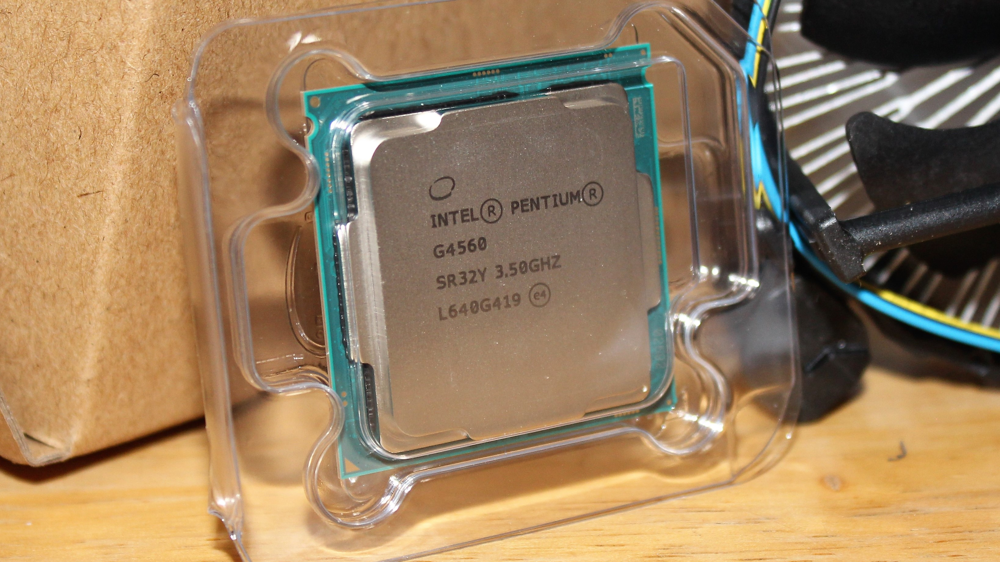
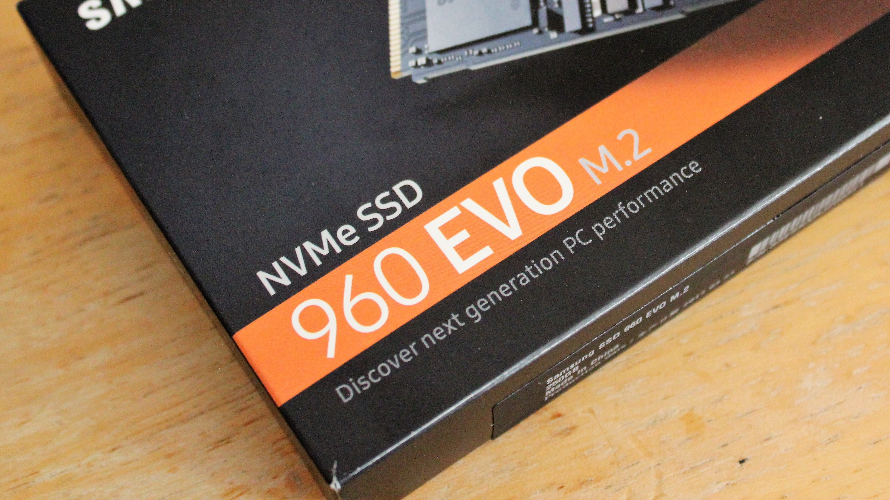
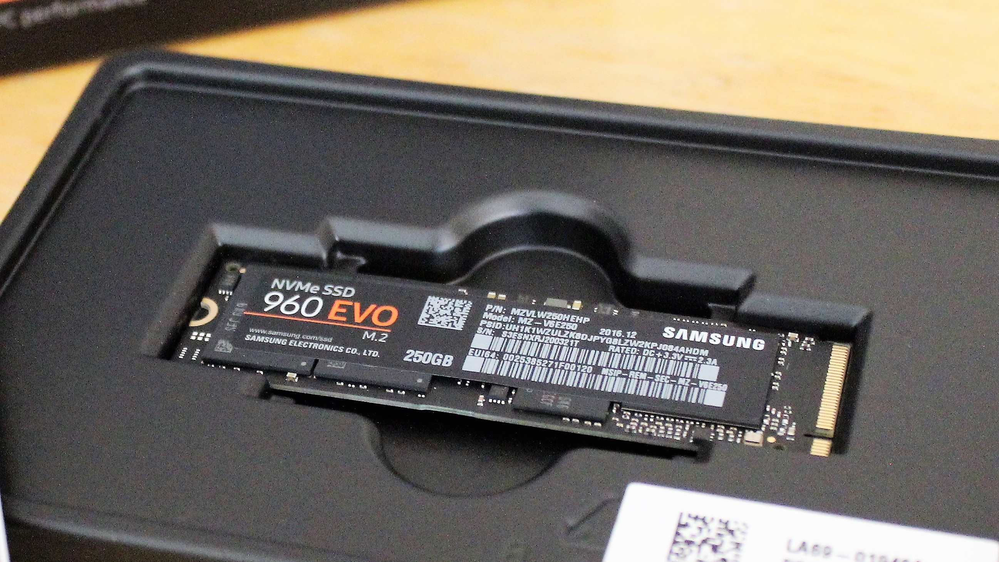
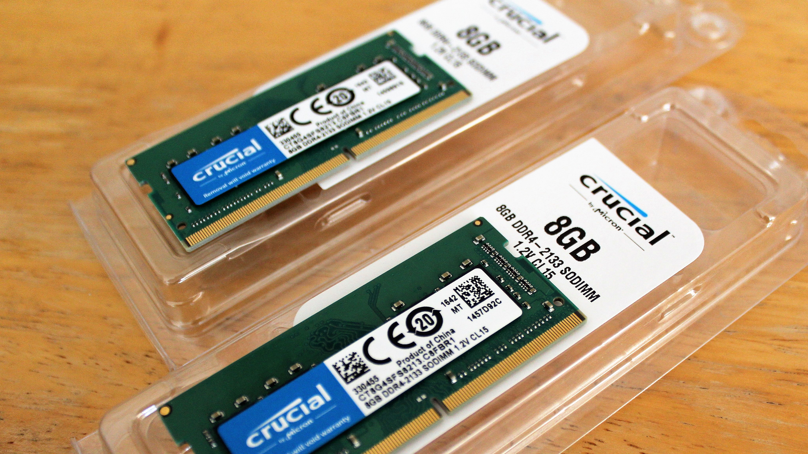
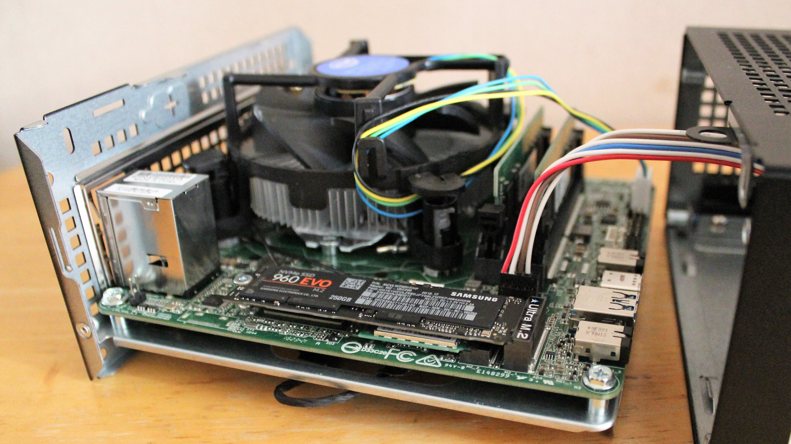
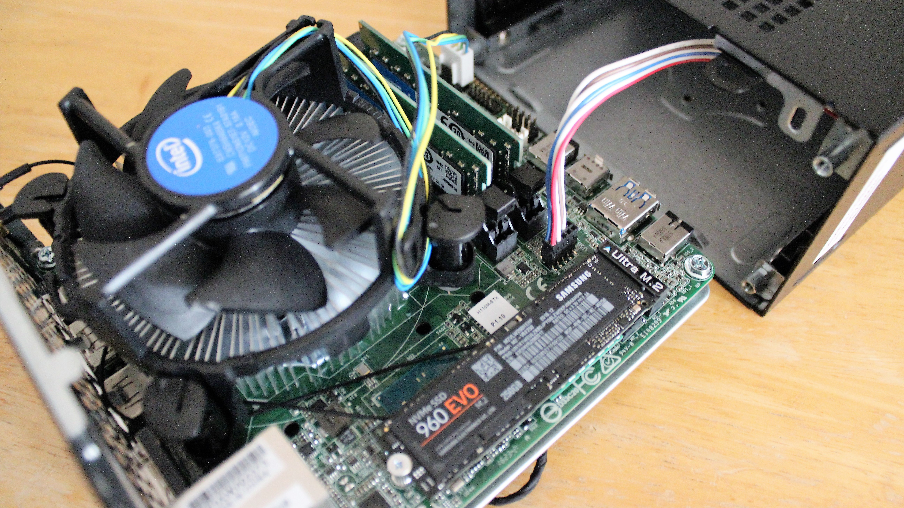
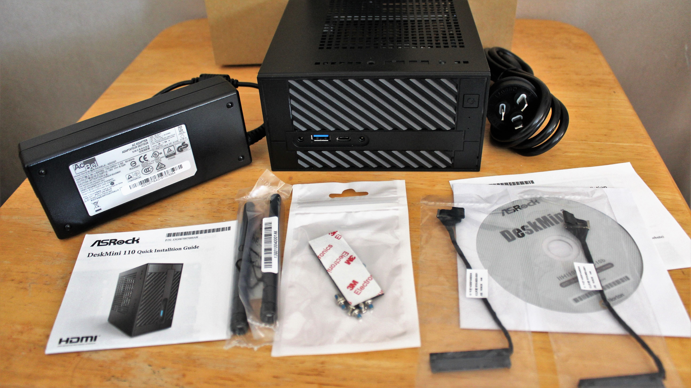
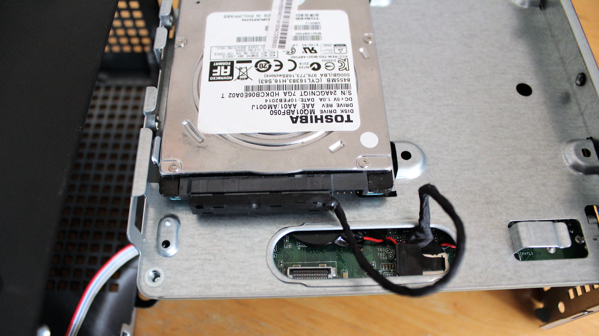
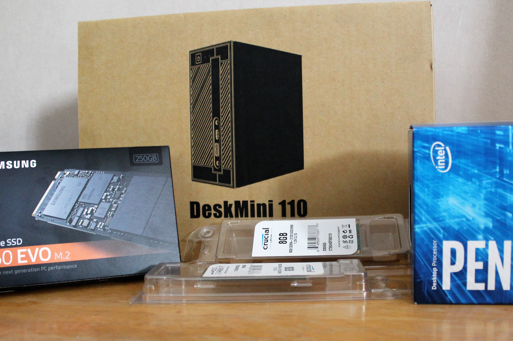

About 8 months ago when I saw the Intel NUC at local computer store, I thought maybe I could get one for my expirements/projects. One that I could just leave running (headless) on one corner and either do of the following:

* Remote SSH from a local coffee shop: download stuff, etc
* Remote development while travelling overseas where internet speed isn't great

I did a bit of research about Intel NUC, just wanted to make sure that it will be worthy for the price that I'd be paying for. However as I dig more info about it - blogs, reviews and forums - the following tipped off the scale for NUC:

* Price
* Hardware Upgrades

## Hardware

The Toshiba and Western Digital SATA disks are old stuff I pulled out from an old laptop.

| Name | Type  | Spec | Additional Info |
|------|-------|------|-----------------|
| ASRock Deskmini | Barebone PC | H110M-STX, 110W (Wireless version) | [ASRock Website info](http://www.asrock.com/nettop/intel/Deskmini%20110%20Series/index.asp) |
| Intel G4560 Pentium  | CPU | 3.50GHz, 2 Cores | [Intel-Pentium-G4560-vs-Intel-Core-i3-6100](http://cpu.userbenchmark.com/Compare/Intel-Pentium-G4560-vs-Intel-Core-i3-6100/3892vs3511) |
| Samsung 960 EVO | SSD | 250GB, M.2, PCIe | [Tom's Hardware review on 960 EVO NVMe SSD](http://www.tomshardware.com/reviews/samsung-960-evo-nvme-ssd-review,4802.html)
| Crucial SODIMM | RAM | 2x8GB, DDR4-2133 | [crucial info](http://www.crucial.com/usa/en/ct8g4sfd8213) |
| TOSHIBA MQ01ABF050 | SATA | 500GB 5400 RPM 8MB Cache SATA 6.0Gb/s 2.5" | [newegg.com TOSHIBA MQ01ABF050](https://www.newegg.com/Product/Product.aspx?Item=1Z4-000B-00003) |
| Western Digital WD2500BEVT | SATA | 250GB 5400 RPM 8MB Cache SATA 3.0Gb/s 2.5" | [newegg.com Western Digital WD2500BEVT](https://www.newegg.com/Product/Product.aspx?Item=N82E16822136387) |

## Gallery

Here are a couple of shots of my Deskmini and its components.

<figure><figcaption>Pentium LGA1151</figcaption></figure>
<figure><figcaption>Pentium G4560</figcaption></figure>
<figure><figcaption>960 EVO M.2 Box</figcaption></figure>
<figure><figcaption>960 EVO 250GB SSD</figcaption></figure>
<figure><figcaption>Crucial 2x8GB DDR4 RAM</figcaption></figure>
<figure><figcaption>Side View: Assembled Deskmini</figcaption></figure>
<figure><figcaption>Top View: Assembled Deskmini</figcaption></figure>
<figure><figcaption>Deskmini Contents</figcaption></figure>
<figure><figcaption>Bottom View: Toshiba SATA Disk</figcaption></figure>
<figure><figcaption>Deskmini, RAM, SSD, CPU</figcaption></figure>

## Issues

It wouldn't be an exciting stuff if there are no issues, don't you think ?

#### BIOS & Kaby Lake

Once you get the build done and pushed the start button - *IT WON'T BOOT THE F\*\*K UP!* why?! - Kaby Lake processor needs UEFI/BIOS version 7.0 or greater. To fix this issue you either need to do the following:

  - Ask the retailers/tech guys to flash the BIOS for you - before handling over your money, this is what I did.
  - Get a spare Skylake processor, boot it up on Windows and flash the BIOS with your barehand.

## Future Plan

Obviously we want the best, fastest and the latest - so my wishlist for this box are:

  - [Noctua NH-L9i](http://noctua.at/en/nh-l9i)
  - [Intel Skylake Core i7 6700K 4.0Ghz 8MB LGA 1151](https://ark.intel.com/products/88195/Intel-Core-i7-6700K-Processor-8M-Cache-up-to-4_20-GHz)
  - [Vengeance® Series 32GB (2 x 16GB) DDR4 SODIMM ](http://www.corsair.com/en-gb/vengeance-series-32gb-2x16gb-ddr4-sodimm-3000mhz-cl16-memory-kit-cmsx32gx4m2a3000c16)

## Conclusion

Overall I'm happy with this box, gets the job done. It's been just few weeks since I built this and its current uptime is 11 days.
The OS is Ubuntu Server 16.04.2 LTS + Docker version 17.03.1-ce with 3 running Docker containers for my fullstack development.
Head over at the references below should you need more details.

I will have another blog for the OS and development experience so stay tuned.

## References

* https://www.youtube.com/watch?v=8j-u7B5nzAk
* http://www.asrock.com/nettop/intel/Deskmini%20110%20Series/index.asp#Gallery
* https://www.ubuntu.com/download/desktop/create-a-usb-stick-on-windows
* https://www-ssl.intel.com/content/www/us/en/products/boards-kits/nuc.html
* http://forum.asrock.com/forum_posts.asp?TID=4552&title=deskmini-110-kaby-lake-bios
* https://hardforum.com/threads/help-intel-skull-canyon-nuc-or-asrock-mini-stx-deskmini-110-with-i7-6700.1908805/
