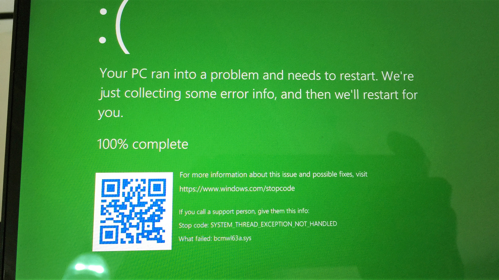
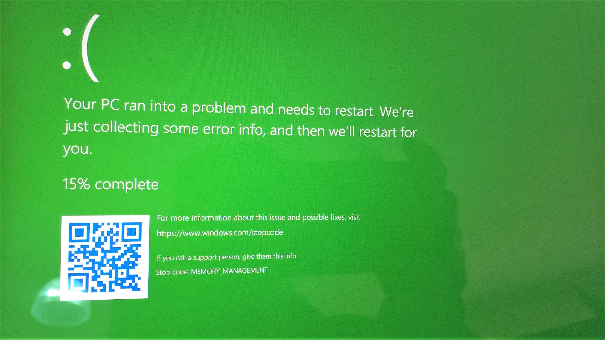
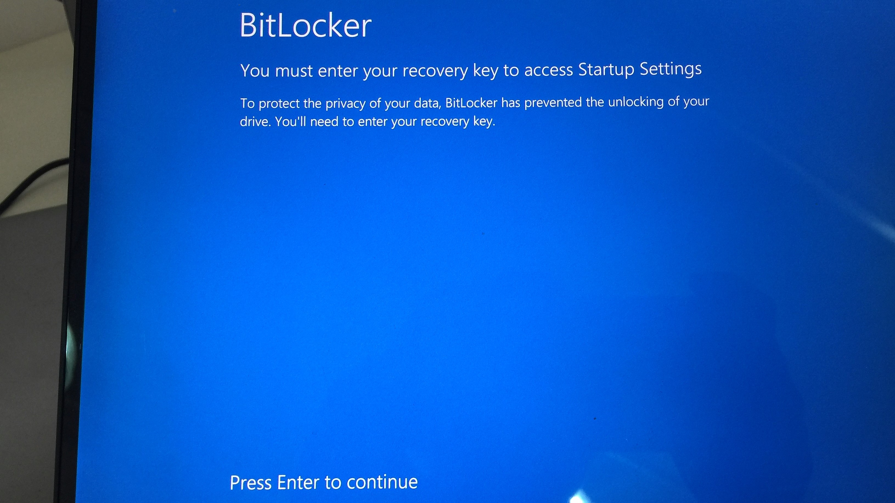

I bought the idea of encrypting my OS drive, since I'm on Windows 10 I opted the closed source utility called BitLocker.
Prior to trusting my gut - I had initially configured my Ubuntu-based headless server with [eCryptfs](http://ecryptfs.org).

If you peek at [eCryptfs about page](http://ecryptfs.org/about.html), one of the authors became a member of BitLocker team at Microsoft - so I guess that's why I pushed the "OK" button.

## The Famous bcmwl63a.sys

The trouble started 2 days after Windows 10 Insider Preview Build [16188](https://blogs.windows.com/windowsexperience/2017/05/04/announcing-windows-10-insider-preview-build-16188-pc-build-15210-mobile) was installed, the drive was already blanketed with BitLocker's thick layer of goodness (I do really hope!).

If you google: bcmwl63a.sys - you will get a good list

> 8,870 results (0.48 seconds)

Got the brand new Green Screen of Death w/ Emoji (GSoD+E), rebooted my machine at least 10 times before I decided to fallback in recovery mode because I need to reinstall the WiFi driver.

<figure><figcaption>bcmwl63a.sys in Action</figcaption></figure>
<figure><figcaption>Green Screen of Death with Emoji</figcaption></figure>

## Recovery Mode == BitLocker Keys

Yep in recovery mode your BitLocker is required - no escaping, so make sure to get it where you kept it.

<figure><figcaption>BitLocker asking for recovery key</figcaption></figure>

## Observation

With just days of using BitLocker, I can't say much other than this epic driver issue.

## References

* http://ecryptfs.org
* https://en.wikipedia.org/wiki/BitLocker
* https://blogs.windows.com/windowsexperience/2017/05/04/announcing-windows-10-insider-preview-build-16188-pc-build-15210-mobile
