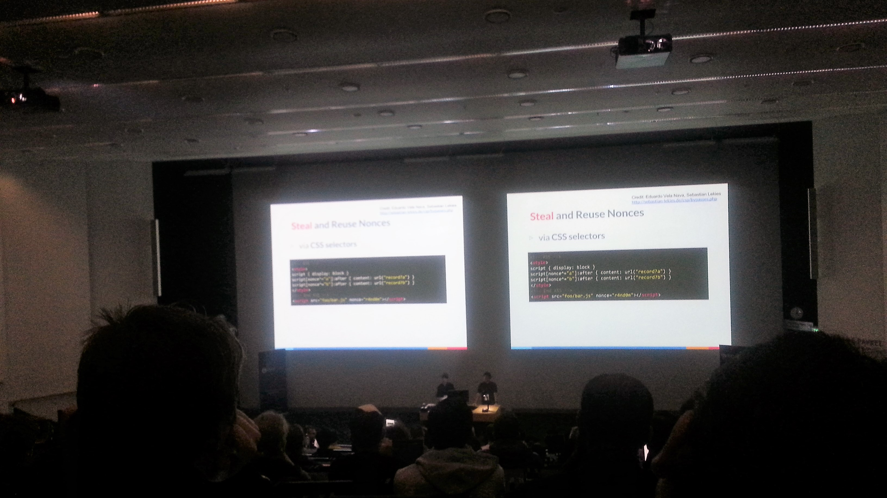
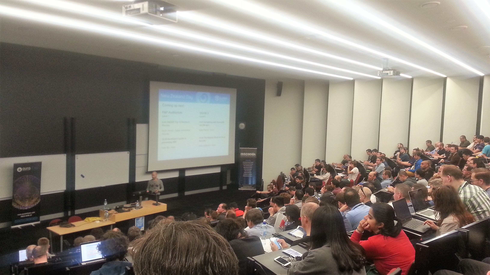
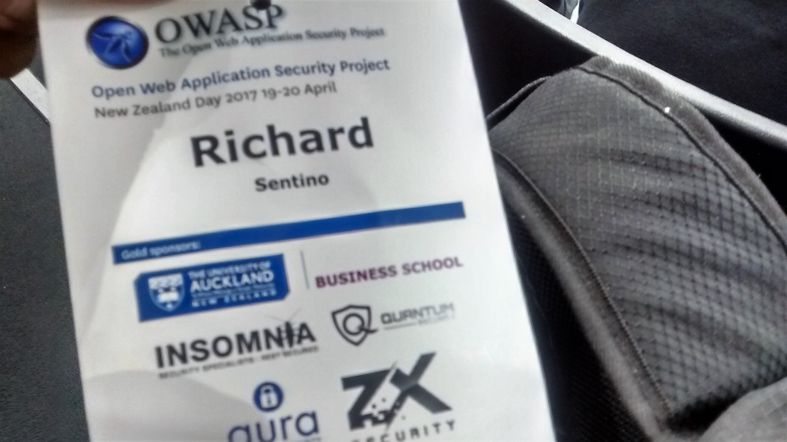
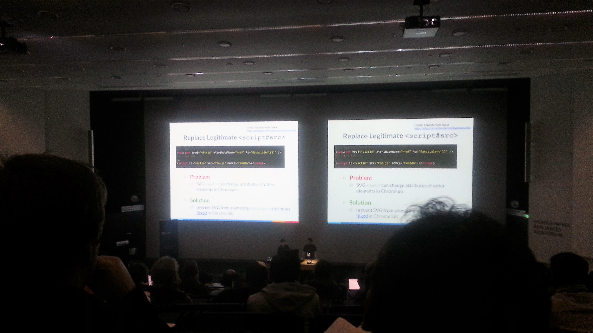
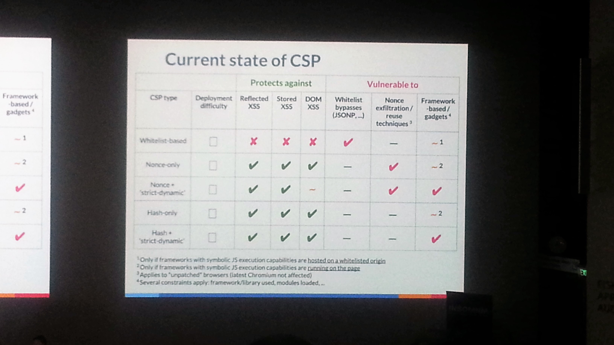
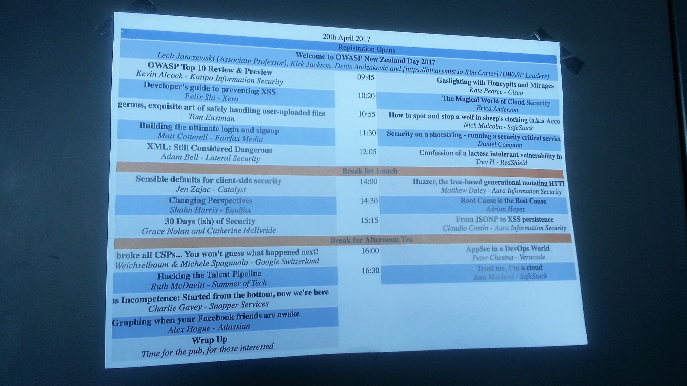
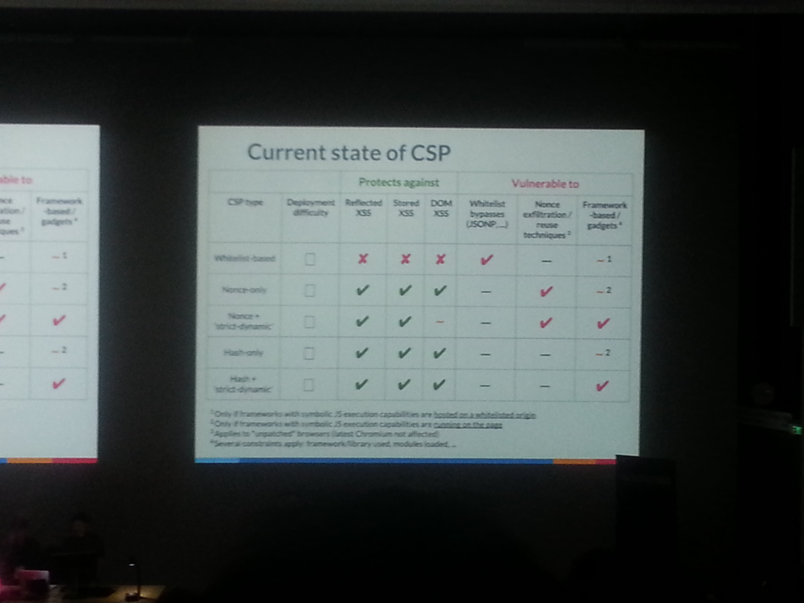
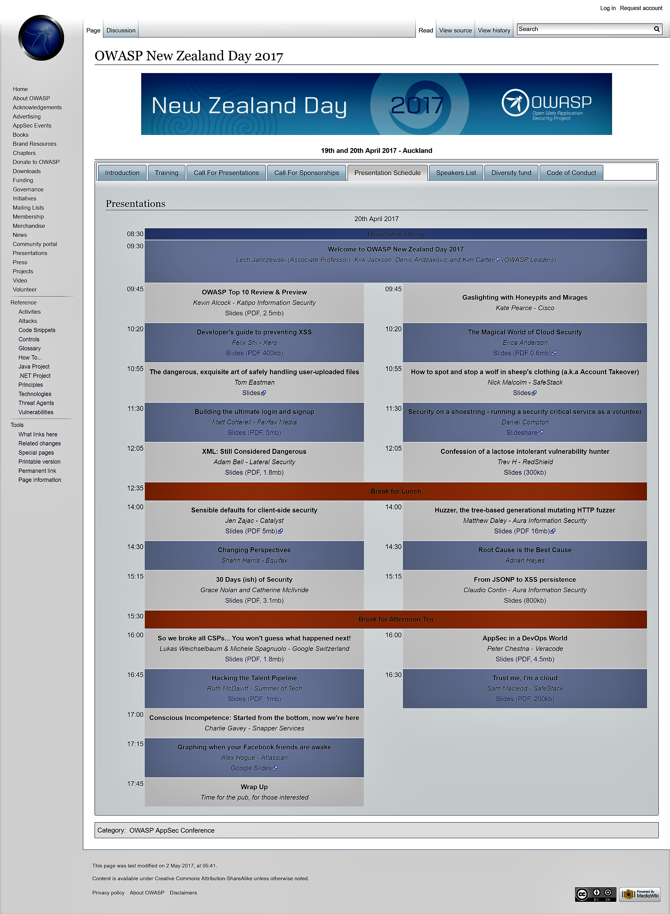

Alright! this was my 2nd year in a row for this web security conference here in Auckland, New Zealand. This is the type conference that would never fails to impress myself: the work and research they've (personal or business related) is great.

They had a good list of local and international speakers, which I think - particularly for inviting international speakers - is good the fact that the audience (like me) will get a different insights outside of the local security threats/tools or knowledge in general.

## Observation

The attendees were asked about how many are devs, pms, QA. Here's a quick recap:

* No CEO, yep none - on holiday I guess
* 1 Project Manager
* then a mixed of devs, QA, Manager, students, SecOps, etc

## The Absence of Higher Ops

The lack of presence of CEOs, PMs, VPs makes the security process just a the second thought - in company practice. PERIOD.

> You can see the sad faces of SecOps people when confronted with reality.

## Gallery

Here are few shots from the conference, not the great but enjoy

<figure><figcaption>Steal and Reuse Nonces</figcaption></figure>
<figure><figcaption>At the Uni Hall</figcaption></figure>
<figure><figcaption>Ma Badge</figcaption></figure>
<figure><figcaption>Script Tag</figcaption></figure>
<figure><figcaption>Current State of CSP cont.</figcaption></figure>
<figure><figcaption>Schedule of Talks </figcaption></figure>
<figure><figcaption>Current State of CSP</figcaption></figure>
<figure><figcaption>Full Schedule with Speakers and links to their slides</figcaption></figure>

## Final Thoughts

I would definitely attend the next conference. It's a free conference but I don't mind making a donation should there be an option at the pre-registration, usually announced 2-3 months before the actual conference. In fact I'd encourage them to ask for donations from individuals, optional of course.

## References

* https://www.owasp.org/index.php/OWASP_New_Zealand_Day_2017
* http://www.bmc.com/it-solutions/secops-security-operations.html
