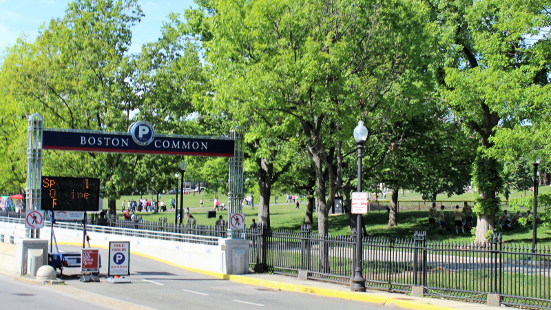
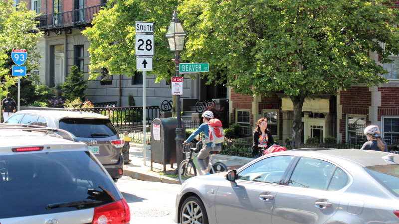
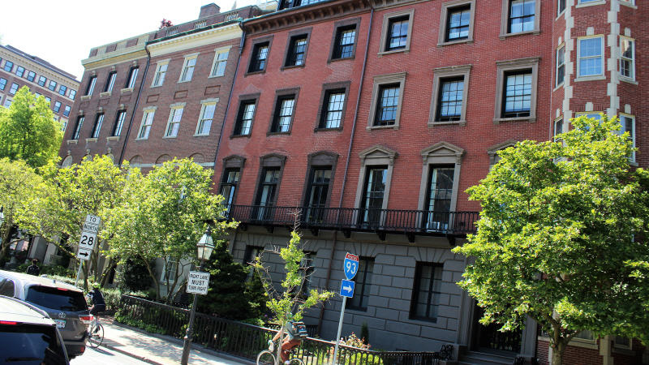
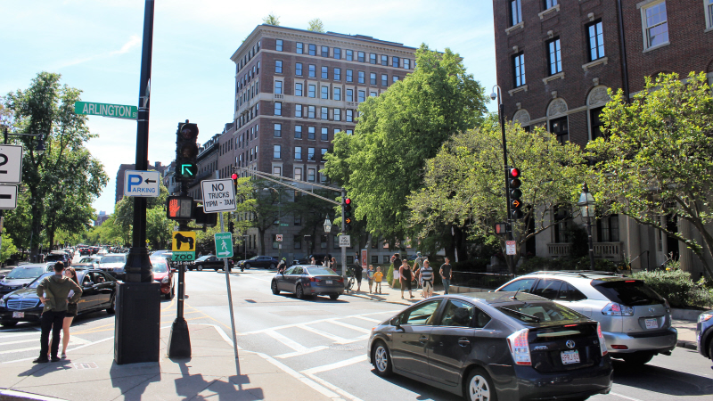
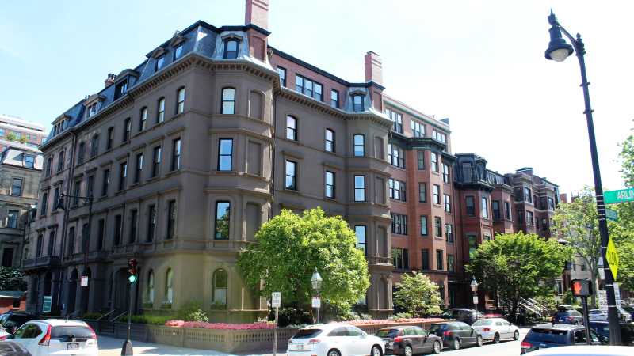
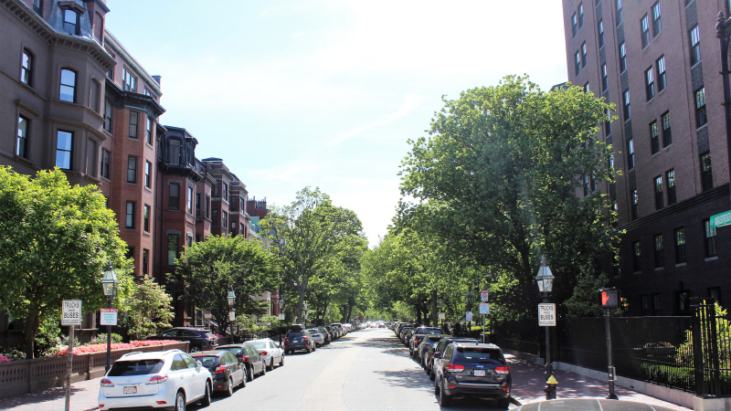
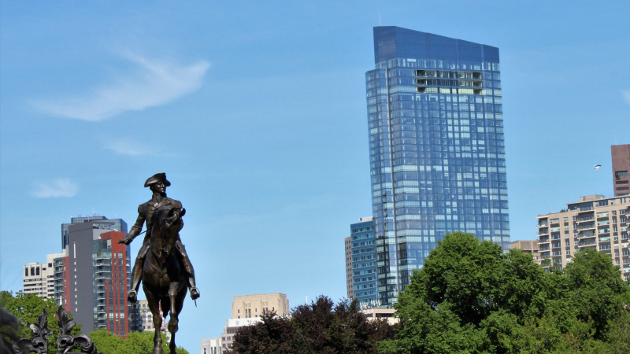
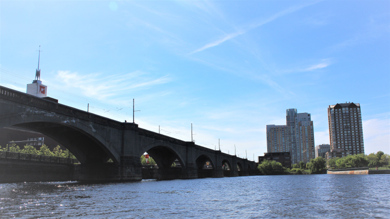
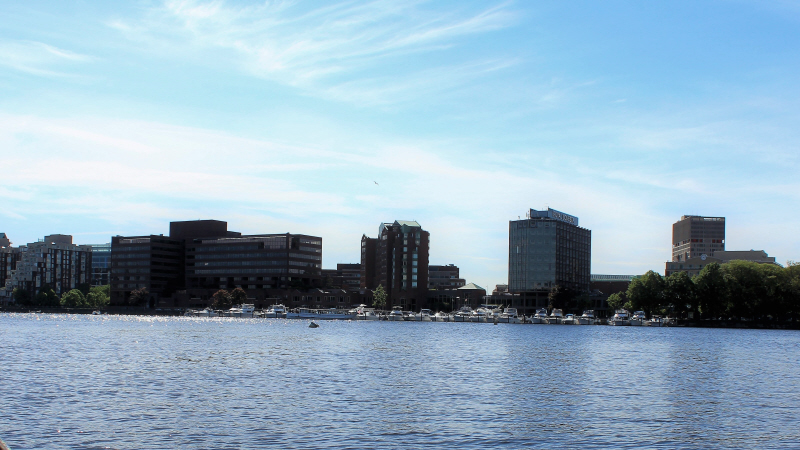

Last week I had the privileged to travel and visit Boston, USA. It's old but a great & lovely city. Food are bit cheaper than NZ, oops!

I was looking for great coffee but sad to say I didn't find a good one, sorry, NZ's coffee still the best - even the petrol station near at my place was way better.

On the bright side, in Boston, food was epic! here are a few food places I went to:

* James Hook & Co
* Kashmir Restaurant
* Legal Seafood
* Red Lantern Restaurant & Lounge
* Trident Booksellers & Cafe
* Pret A Manger
* Luke's Lobster Back Bay
* Starbucks

It was primarily a business/conference trip and I've managed to drop by at following offices:

* Brightcove HQ
* Akamai Technologies HQ

Probably my longest air travel spent 6 hours from Boston to Houston then 14+ hours mid-air from Houston to Auckland. Again, the place is awesome.

I snapped a couple of shots:

<figure><figcaption>IMG_1001</figcaption></figure>
<figure><figcaption>IMG_1002</figcaption></figure>
<figure><figcaption>IMG_1003</figcaption></figure>
<figure><figcaption>IMG_1004</figcaption></figure>
<figure><figcaption>IMG_1005</figcaption></figure>
<figure><figcaption>IMG_1006</figcaption></figure>
<figure><figcaption>IMG_1007</figcaption></figure>
<figure><figcaption>IMG_1011</figcaption></figure>
<figure><figcaption>IMG_1014</figcaption></figure>

thanks!
