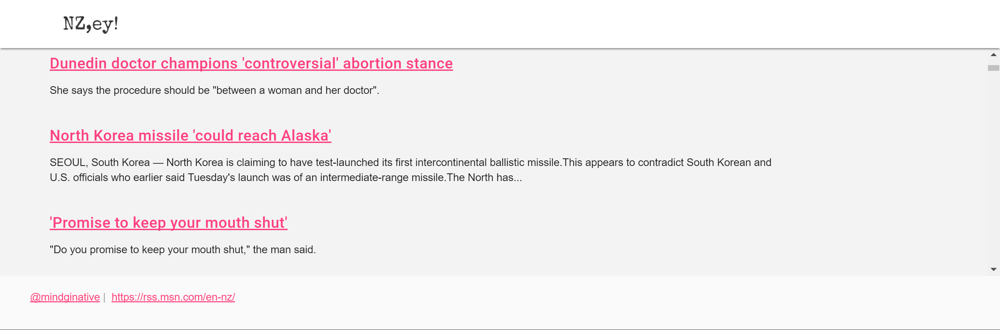

One thing I kept hearing as part of the requirements: `React`

I don't have a production experience with React, however, IMHO if a developer has done a bit of JS development in the past I don't think onboarding is rocket science.

> At the end of the day, it's just JavaScript!

I'm currently working on a couple of personal projects and thought of using React at some stage but instead I've decided to do hackathon on a simple React project and see where it would take me, I didn't set a deadline.

## My Requirements

* Simple RSS news feed reader
* Setup a custom domain for github pages
* Setup DNS CNAME under my mindginative.com domain, via AWS Route53
* Build and deployment scripts
* Use Material design
* Development and production test environment

The list above looks daunting BUT this is 2017! this isn't 1999 - 6 CDs of VB6 MSDN.

## On building "NZ,ey!" RSS news reader

The boilerplate project [Create React App](https://github.com/facebookincubator/create-react-app), did most of the gory details for me while I sat down and work
on the first iteration of the web app.

## Conclusion

I think I managed to get up and running the web app from nothing to a working version within 12 hours.

My take on React? onboarding is damn easy

## Links

* NZ,ey! RSS reader http://nzey.mindginative.com/
* Source code https://github.com/rixrix/nzey
* https://github.com/facebookincubator/create-react-app
