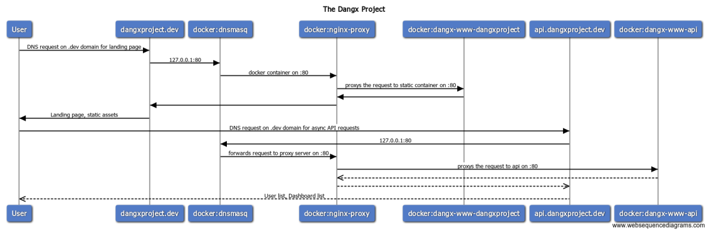
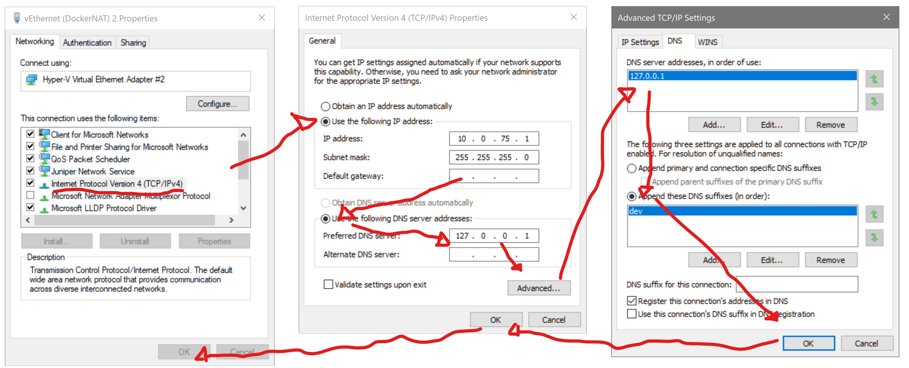

Apology for the last word "Win10", it's bit misleading but my main development machine is Dell XPS 13 on Windows 10 Pro Insider Preview. There's should be a follow up to this blog hopefully on my [headless Ubuntu Server](/notes/2017/05/11/asrock-h110m-stx-deskmini-110w-with-headless-ubuntu-server/).

BTW, it's a PITA to get this thing working on my Win10 machine - too many wrangling with Windows GUI DNS settings, Docker vEthernet adapter then a mixed of CLI scripts, some won't work on plain CLI commands later then I discovered that wrapping it inside docker-compose.yml does the trick. C-R-A-Z-Y-!

## Rationale

I had this vision from last year (2016) while I was working on couple projects: NodeJS APIs, setting up infras (CI), deployments, standing up AWS services -  to do some automated orchestration of infrastructures and its services, stick inside a container. It just got materialised recently, and with some help from [1] [2].

## Dangx Project

Dangx Project is an attempt to build a microservice architecture with Docker, Alpine Linux, NodeJS, Nginx. Each service should run on its own isolated container.

see https://github.com/rixrix/dangx-project/tree/v1.0.0

### Configuration

* Except for Dnsmasq, all containers are linked via the "nginx-proxy" network
* Dnsmasq[4] will only respond to "dev" domain queries on localhost/127.0.0.1
  * `--address=/dev/127.0.0.1`
* Configure your Windows Docker vEthernet (DockerNAT) network adapter to use the 127.0.0.1 as one of your DNS server and use DNS suffix "dev", see screenshot above

### How it works

* Dnsmasq responds to "dev" domain queries and use 127.0.0.1 as its IP
* Nginx Proxy listens for any request on port 80, proxys the request to its target container, it does a lot of cool magic behind the scene, see [3]
* Domain and its containers
  * http://dangxproject.dev
      * dangx-www-dangxproject
      * Nginx static server
  * http://api.dangxproject.dev
      * dangx-www-api
      * NodeJS/Express server
  * http://whoami.dangxproject.dev
      * dangx-www-whoami
      * Nginx test server

### Commands

* For fresh project, create the special network
  * `./scripts/docker-new-network.sh`
* Build the containers
  * `./scripts/docker-compose-up.sh`
* Destroy the containers, excluding network and images
  * `./scripts/docker-compose-down.sh`
* Restart the containers
  * `./scripts/docker-compose-restart.sh`

## Note

This is a short write up about its purpose, functionality and configuration, feel free to ask or file an [issue over at Github](https://github.com/rixrix/dangx-project). The references below should give you the nitty-gritty.

## Future Plan

I'm excited about the current state of this project, and I'd like to move forward and do some cool stuff. Here's the grand plan:

* Deploy to AWS
* Infrastructure management with Terraform.io
* Multi-cloud deployment eg: Google Cloud, AWS, Azure
* CI (automated: testing, deployment)
* Security (SSL, etc)
* Blue/Green deployment
* Spin-off sample/cool projects from this project

## References

* [1] http://blog.ibmjstart.net/2015/07/23/learning-microservices-architecture-bluemix-docker-part-1/
* [2] https://adrianperez.org/improving-dev-environments-all-the-http-things/
* [3] https://hub.docker.com/r/jwilder/nginx-proxy/
* [4] https://hub.docker.com/r/andyshinn/dnsmasq/
