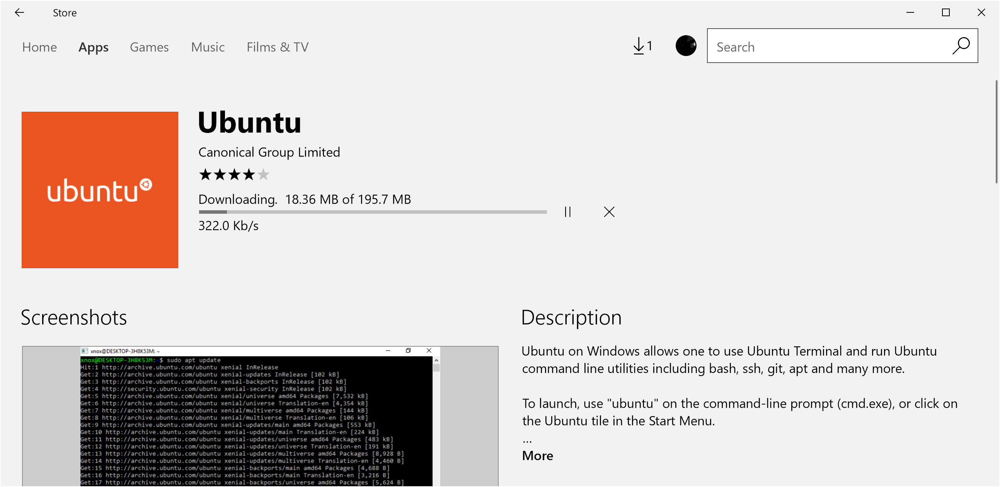

Today I learned that I can install Ubuntu or Suse Linux, straight from Windows App Store.
I might have missed the opportunity which was announced [4 months ago](https://blogs.msdn.microsoft.com/commandline/2017/06/08/developer-mode-no-longer-required-for-windows-subsystem-for-linux/)

### Notes

This is my first post of "Today I Learned" series of mini-blog: a mixed of tips, resources or anything. I spent at least 8 hours in front of the screen - coding and always learning.
