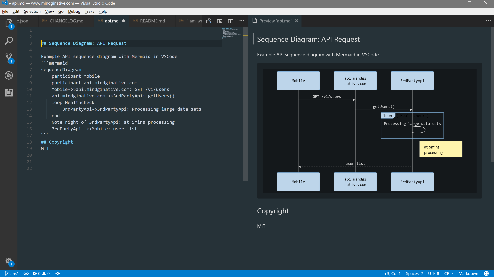

Documenting API flow is best when coupled with UML. There exists more than a dozen tools, special IDE, web apps: turn your UML script into beautiful visual presentation.

Most of the time you will end with the classic scenario:

- Write UML script
- Save
- Export as png, or PDF

With [VScode Mermaid Preview](https://marketplace.visualstudio.com/items?itemName=vstirbu.vscode-mermaid-preview) it's never been easier writing your UML script embedded within your Markdown document. It's built on top of [Mermaid.js](https://mermaidjs.github.io/)

Enjoy!
