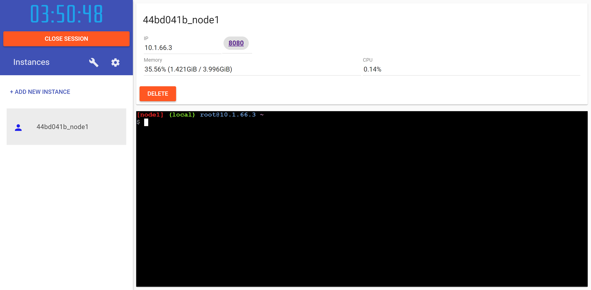

## Docker Playground



Came across this little web service [Docker Playground](http://labs.play-with-docker.com/), spinning up a full Docker environment took only seconds.

## Hardware and System Info

```bash
$ uname -a
Linux node1 4.4.0-1035-aws #44-Ubuntu SMP Tue Sep 12 17:27:47 UTC 2017 x86_64 Linux
```

```bash
$ lshw -short
H/W path    Device       Class      Description
===============================================
                         system     HVM domU
/0                       bus        Motherboard
/0/0                     memory     96KiB BIOS
/0/1                     processor  Intel(R) Xeon(R) CPU E5-2670 v2 @ 2.50GHz
/0/2                     processor  CPU
/0/3                     processor  CPU
/0/4                     processor  CPU
/0/5                     processor  CPU
/0/6                     processor  CPU
/0/7                     processor  CPU
/0/8                     processor  CPU
/0/9                     memory     System Memory
/0/9/0                   memory     16GiB DIMM RAM
/0/9/1                   memory     16GiB DIMM RAM
/0/9/2                   memory     16GiB DIMM RAM
/0/9/3                   memory     13GiB DIMM RAM
/0/9/4                   memory     16GiB DIMM RAM
/0/9/5                   memory     16GiB DIMM RAM
/0/9/6                   memory     16GiB DIMM RAM
/0/9/7                   memory     13GiB DIMM RAM
/0/a                     memory     96KiB BIOS
/0/b                     processor  CPU
/0/c                     processor  CPU
/0/d                     processor  CPU
/0/e                     processor  CPU
/0/f                     processor  CPU
/0/10                    processor  CPU
/0/11                    processor  CPU
/0/12                    processor  CPU
/0/13                    memory     System Memory
/0/14                    memory
/0/15                    memory
/0/100                   bridge     440FX - 82441FX PMC [Natoma]
/0/100/1                 bridge     82371SB PIIX3 ISA [Natoma/Triton II]
/0/100/1.1               storage    82371SB PIIX3 IDE [Natoma/Triton II]
/0/100/1.3               bridge     82371AB/EB/MB PIIX4 ACPI
/0/100/2                 display    GD 5446
/0/100/3                 network    82599 Ethernet Controller Virtual Function
/0/100/1f                generic    Xen Platform Device
/1          vethc357ce0  network    Ethernet interface
/2          veth2d71b4d  network    Ethernet interface
/3          vetha92acfa  network    Ethernet interface
/4          eth1         network    Ethernet interface
/5          eth0         network    Ethernet interface
```

Enjoy!
